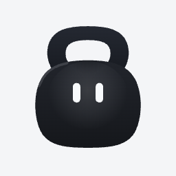
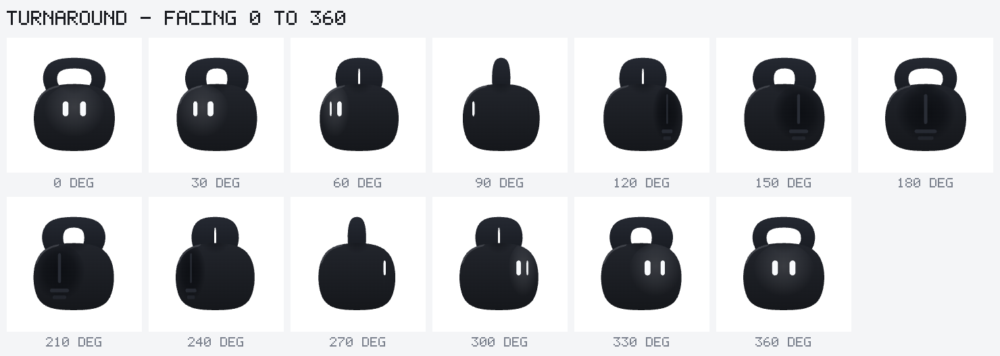
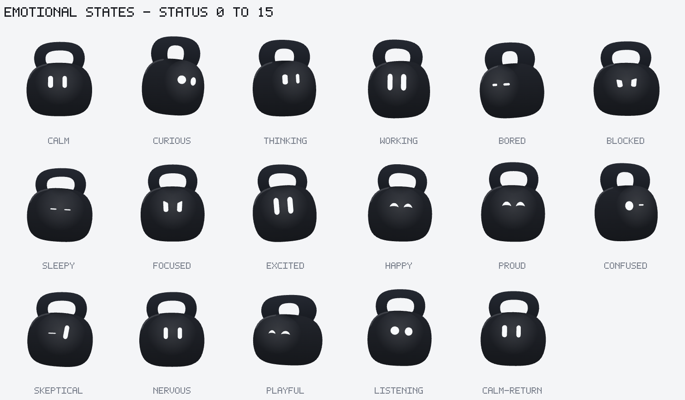

# Kettlebell Bot

A vector Rive avatar for mobile apps. It is a charcoal kettlebell that turns a
full 360 degrees, holds sixteen distinct emotional states, and reacts, blinks,
looks around and responds to touch — all composable, all driven by one state
machine.



| | |
|---|---|
| Turnaround, all 13 facings |  |
| All 16 emotional states |  |

Animated: [`previews/animations/showcase_turnaround.gif`](previews/animations/showcase_turnaround.gif) ·
[`previews/animations/showcase_emotions.gif`](previews/animations/showcase_emotions.gif)

## What is in the box

- `rive/kettlebell-bot.riv` — the runtime asset. Rive format 7.0, 181 KB,
  transparent, no embedded images.
- `rive/kettlebell-bot.scene.json` — the full reproducible scene the `.riv` is
  built from.
- `assets/svg/kettlebell-bot.svg` — the editable vector source, layered and named
  to match the Rive rig.
- `assets/svg/kettlebell-bot-turnaround.svg` — seven facings drawn by the same
  projection model the `.riv` animates.
- `examples/KettlebellBot.tsx` — React wrapper with drag-to-turn, tap, hover and
  pointer-tracked gaze.
- `specs/` — avatar, animation, integration and validation specifications.
- `previews/` — an animated preview per animation, contact sheets, state-machine
  captures and critique filmstrips.

## The rig, briefly

A flat rotation cannot sell a turn for this character, so the yaw is a small
projection model rather than a set of drawn poses. One angle drives everything:

- **The handle is a flat plate.** Its projected width is `|cos a|` plus its own
  depth times `|sin a|`, and its opening closes faster than the outer silhouette
  because the near arm occludes the far one. The opening is gone by 64 degrees;
  the arch bottoms out at 30% of its width at true profile.
- **The eyes ride a cylinder.** They wrap around the form, foreshorten, stall at
  the limb and pass out of sight, then reappear from the other side.
- **A front light field and a back dark field counter-slide** across the bell,
  giving it a near surface and a far one. Turned away, a seam and two vents make
  the back readable as a back.

The held facings, the scripted head turns and the full spins are the same maths
sampled differently, so they can never disagree.

The state machine has eight layers, each owning a disjoint set of properties:
Energy, Touch, Turn, Mood, Reaction, Gaze X, Gaze Y and Blink. That is what lets
a mood, a facing, a gaze direction, a blink and a press all play at once instead
of overriding one another — and it is checked at build time, so a violation fails
the build rather than producing a subtly wrong file.

## Using it

```tsx
import { KettlebellBot, type KettlebellBotHandle } from "./KettlebellBot";

const bot = useRef<KettlebellBotHandle>(null);

<KettlebellBot ref={bot} mood="working" intensity={0.7} />;

bot.current?.celebrate();   // finished
bot.current?.turnaround();  // full 360
bot.current?.lookAt(-0.6, 0.2);
```

Inputs: `status` (0–15), `facing` (0–360), `gazeX`/`gazeY` (-1–1),
`intensity` (0–1), `hover`, `pressed`, and 17 triggers. Full table in
[`specs/integration-contract.md`](specs/integration-contract.md).

## Building

Everything is generated from `scripts/lib/geometry.mjs` — the SVG source and the
Rive scene are built from the same numbers, so they cannot drift apart.

```sh
npm run build      # SVG + .riv (validates first, refuses to write on error)
npm run check      # validate and write the scene JSON only, no MCP round trip
npm run verify     # is the committed .riv still what the source produces?
npm run test       # drive every state-machine input and transition
npm run previews   # one animated preview per animation, plus static renders
npm run sheets     # contact sheets for turnaround, emotions, reactions, touch
npm run critique   # filmstrips, onion skins and contact sheets; tag it: npm run critique -- pass3
npm run lint:riv   # riv_lint
npm run studio     # local Rive Studio at http://localhost:8787
npm run all        # build, test, previews, sheets
```

If you open the asset in Rive Studio or any editor that can save back to
`rive/kettlebell-bot.{riv,scene.json}`, run `npm run verify` afterwards. The
build is byte-deterministic, so it can tell you exactly which shape or property
drifted — an editor round-trip can quietly add things the source never had, such
as a default fill on a stroke-only path.

Source layout:

```text
scripts/lib/geometry.mjs    artwork: paths, eye variants, palette, depth layers
scripts/lib/turn.mjs        the yaw projection model and its track generator
scripts/lib/motion.mjs      channel helpers, easing tokens, volume compensation
scripts/lib/moods.mjs       the 16 persistent mood loops
scripts/lib/reactions.mjs   the 10 one-shots and the 3 blinks
scripts/lib/turnanims.mjs   facing poses, head turns, spins, gaze, energy, touch
scripts/lib/showcase.mjs    preview-only reels, sampled from the real animations
scripts/lib/scene.mjs       rig, artwork and state-machine assembly
scripts/lib/validate.mjs    the build-time guards
scripts/verify-asset.mjs    drift check: committed asset vs. a clean rebuild
scripts/lib/png.mjs         dependency-free PNG reader/writer for contact sheets
scripts/lib/svg.mjs         geometry to SVG path data
```

## Environment

- macOS 27.0 (Apple silicon), Node 26.8.1, npm 11.19.0
- `rive-mcp-server@0.5.0`, registered as the `rive` MCP server:

```sh
npm install -g rive-mcp-server
```

The design guidelines the build follows are installed at
`.claude/skills/rive-design-guidelines/`.

Rive Desktop 0.8.5674 opens the file but shows a blank canvas; the same
format-7.0 file validates and runs its state machine in the current official
runtime. Use a current Rive editor, `npm run studio`, or the scene JSON to
inspect. See [`specs/validation-report.md`](specs/validation-report.md).

## Credits and constraints

Original artwork. The silhouette derives from the supplied kettlebell reference
(kept in `assets/reference/` for provenance only — it is never embedded). Motion
principles — expressive eyes, posture, readable agent states, motion as presence —
were informed by xAI's published Grok Bot design process; no vectors, poses,
timing or visual design were taken from it.
