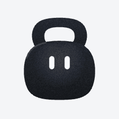
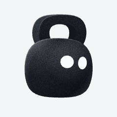

# Kettlebell Bot

Kettlebell Bot is an expressive animated character for a bot or digital assistant. Built in Rive as a charcoal kettlebell, it can communicate what the bot is doing through moods, reactions, gaze and motion.

| A full turn | A range of moods |
|:---:|:---:|
|  |  |

The character has 20 persistent moods, 16 reactions, 14 selectable eye shapes, four particle effects, and a full 360-degree turn. Its state machine composes mood, facing, gaze, blinking and touch so they can play together.


## Try the playground

The local playground lets you explore the character's moods, reactions, gaze, turns and touch interactions. You need Node.js 20.19+ or 22.12+ and npm.

```sh
npm --prefix playground ci
npm run playground
```

Open the local URL printed by Vite. Drag the bot to turn it, move the pointer over it to steer its gaze, or tap it for a reaction. The playground copies the committed Rive asset into its public directory before starting or building.

## Use the character

The ready-to-use asset is [`rive/kettlebell-bot.riv`](rive/kettlebell-bot.riv). Its artboard is `KettlebellBot` and its state machine is `KettlebellBotMachine`. The [integration contract](specs/integration-contract.md) documents every input, trigger and mood value.

For React on the web, [`examples/KettlebellBot.tsx`](examples/KettlebellBot.tsx) provides a copyable wrapper. Install `@rive-app/react-canvas`, copy the wrapper into your project, and serve the `.riv` file at `/kettlebell-bot.riv` (or pass a different URL with the `src` prop):

```tsx
import { useRef } from "react";
import { KettlebellBot, type KettlebellBotHandle } from "./KettlebellBot";

function Assistant() {
  const bot = useRef<KettlebellBotHandle>(null);

  return (
    <>
      <KettlebellBot ref={bot} mood="working" intensity={0.7} />
      <button onClick={() => bot.current?.celebrate()}>Celebrate</button>
    </>
  );
}
```

The wrapper also exposes actions such as `turnaround()`, `lookAt(x, y)`, `setEyes("crescent")` and `fxMotes()`. The Rive file can also be used directly with a compatible Rive runtime; the React wrapper is an example, not a published package.

## Repository guide

- [`rive/`](rive/) — runtime asset and generated scene JSON.
- [`assets/svg/`](assets/svg/) — editable vector artwork, expressions, particles and turnaround.
- [`assets/icon/`](assets/icon/) — still artwork in SVG and PNG formats.
- [`examples/`](examples/) — React integration example.
- [`playground/`](playground/) — interactive control surface.
- [`previews/`](previews/) — animation previews, contact sheets and validation captures.
- [`specs/`](specs/) — artwork, animation, integration and validation details.
- [`scripts/`](scripts/) — geometry, motion, scene generation and verification tools.

## Building and testing

The SVG artwork and Rive scene share geometry in `scripts/lib/geometry.mjs`. The committed `.riv` is ready to use; rebuilding it, rendering previews and running the state-machine tests require the Rive MCP server CLI. The scripts look for the server and its MCP SDK in the global npm installation:

```sh
npm install -g rive-mcp-server@0.5.0
```

With Node.js 20.19+ or 22.12+ installed, run from the repository root:

```sh
npm run build       # regenerate SVGs, scene JSON and Rive asset
npm run check       # validate and write scene JSON without the Rive server
npm run test        # scene checks and Rive state-machine tests
npm run verify      # compare the committed Rive asset with a clean rebuild
npm run previews    # render animated and static previews
npm run sheets      # render contact sheets
npm run review      # render expressions at multiple sizes and on light/dark surfaces
npm run critique    # render filmstrips and onion skins
npm run build:icon  # regenerate the icon SVGs
npm run playground:build
```

`npm run check` writes the scene JSON. The Rive-backed commands also generate or update preview files. If an editor saves changes to the asset, run `npm run verify` to check for drift from the generated source. See the [validation report](specs/validation-report.md) for runtime and editor notes.

## How it works

The turn uses a projection model rather than a flat rotation: the handle reveals its thickness, the eyes wrap around the bell and disappear at its edge, and lighting follows the projected form. The surface grain is made from vector specks. Moods, reactions, turns, gaze, touch and effects are coordinated by twelve state-machine layers; build-time validation checks their channel ownership. The [avatar specification](specs/avatar-spec.md) and [animation specification](specs/animation-spec.md) describe the rig and motion in more detail.

## Credits and usage

The artwork is original. The silhouette was developed from the reference in [`assets/reference/`](assets/reference/), which is not embedded in the Rive asset. Motion principles were informed by xAI's published Grok Bot design process; no vectors, poses, timing or visual design were taken from it.

No license has been specified for this repository. Contact the repository owner for permission before reusing the artwork or code.
